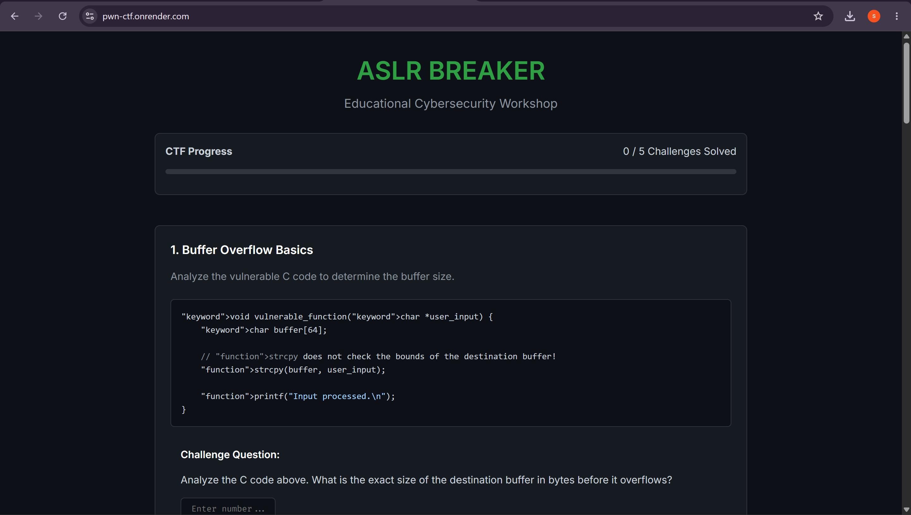
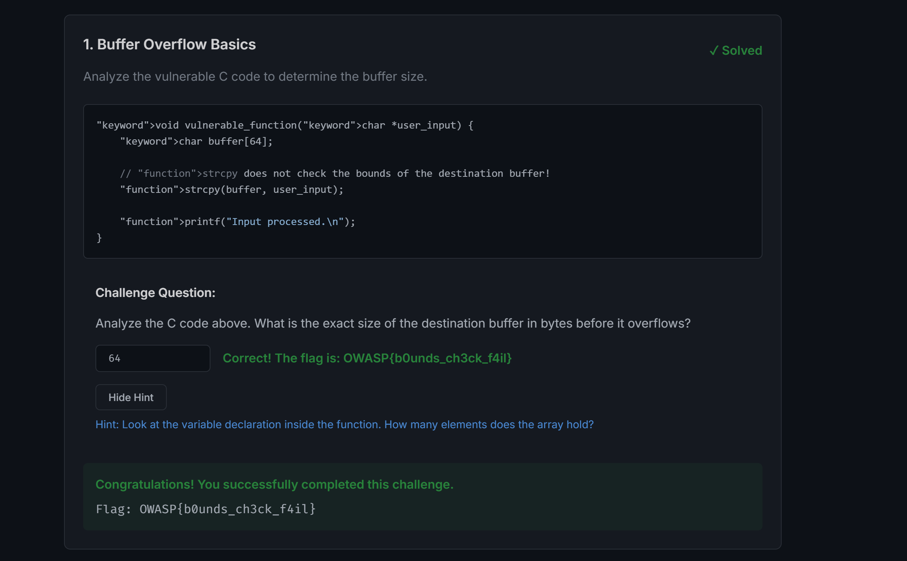
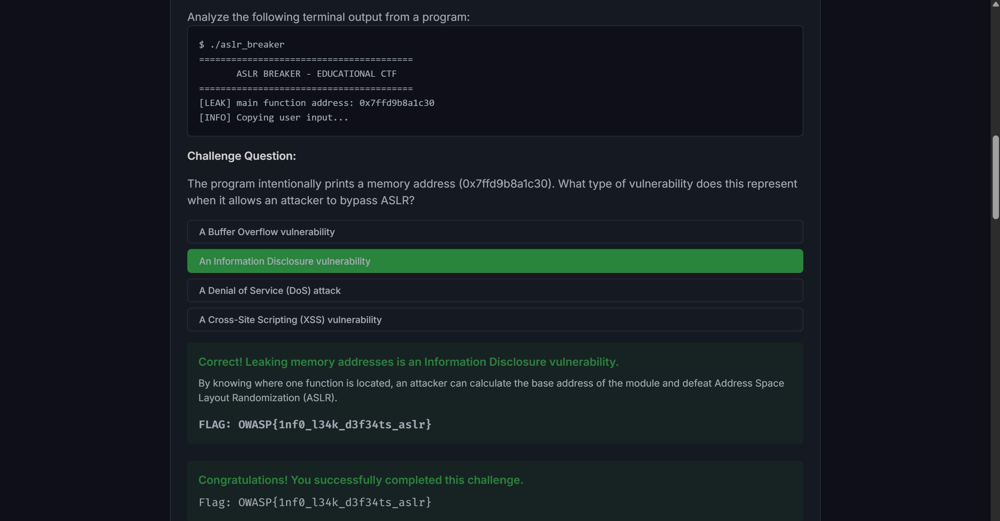
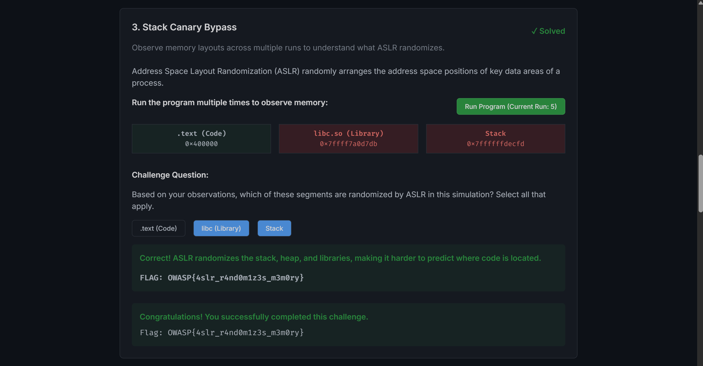
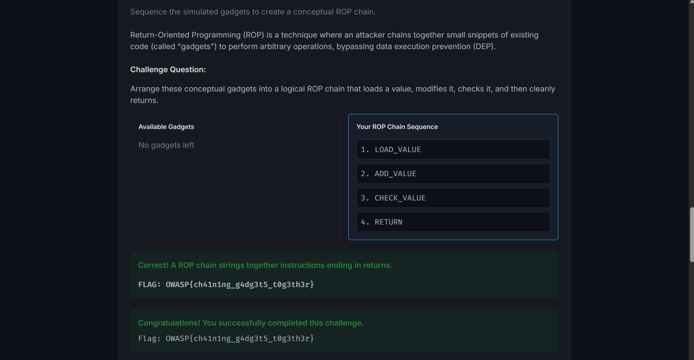
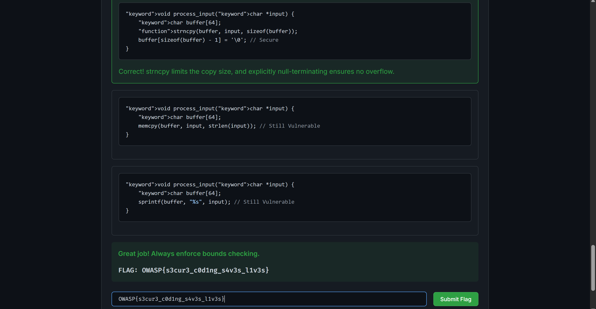
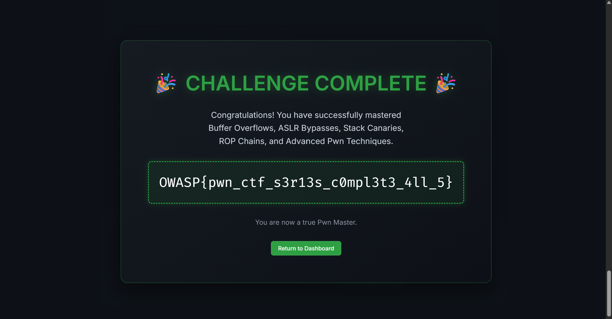

# PWN-CTF: ASLR Breaker (Web Exploitation, Easy)

**Author:** Shreya Gaikwad
**Category:** Web Exploitation
**Difficulty:** Easy

## Challenge Description

> ASLR Breaker is a 5-challenge educational web CTF series on binary exploitation concepts. Each challenge is a self-contained lesson — analyze the code or terminal output, answer the question, and collect the flag. Solve all five to unlock the master flag panel and complete the series.
>
> - **Flag format:** `OWASP{...}` (all six flags)
> - **Deployed at:** `https://pwn-ctf.onrender.com`

## Summary

The target is a frontend-only React application (no backend, no real exploits — a safe teaching simulator). It presents five challenge cards — Buffer Overflow, Information Disclosure, ASLR Simulator, ROP Concepts, Secure Coding — each ending in a flag once the correct answer is given. Each card also has its own **Submit Flag** box: paste the revealed `OWASP{...}` flag there to mark the challenge solved. Solving all five unlocks the locked master-flag panel at the bottom of the page, where entering the series completion flag finishes the CTF.

## Recon

Browsing to the deployed instance shows the ASLR Breaker hub: five challenge cards in order, each expandable, plus a **Final Master Flag** panel at the bottom showing a locked state ("Complete all 5 challenges to unlock the final flag").


*ASLR Breaker hub — five challenge cards and the locked master flag panel*

Each challenge is solved entirely in the browser — no tools beyond reading code and clicking.

## Step 1 — Buffer Overflow: how big is the buffer?

The challenge shows this C code:

```c
void vulnerable_function(char *user_input) {
    char buffer[64];

    // strcpy does not check the bounds of the destination buffer!
    strcpy(buffer, user_input);

    printf("Input processed.\n");
}
```

The question asks for the exact size of the destination buffer in bytes. The declaration `char buffer[64]` gives it away: **64**. Typing `64` into the answer box reveals the flag.


*Answer 64 — flag revealed*

```
OWASP{b0unds_ch3ck_f4il}
```

## Step 2 — Information Disclosure: name the leak

The challenge shows terminal output from a program that prints its own memory address:

```
$ ./aslr_breaker
========================================
       ASLR BREAKER - EDUCATIONAL CTF
========================================
[LEAK] main function address: 0x7ffd9b8a1c30
[INFO] Copying user input...
```

The question: what type of vulnerability does printing a memory address represent when it lets an attacker bypass ASLR? Selecting **"An Information Disclosure vulnerability"** reveals the flag.


*Correct option selected — flag revealed*

```
OWASP{1nf0_l34k_d3f34ts_aslr}
```

## Step 3 — ASLR Simulator: what actually randomizes?

The challenge shows three memory segments — `.text (Code)` at `0x400000`, `libc.so` and `Stack` at high addresses — with a **Run Program** button. Clicking it several times re-randomizes the display: `.text` stays pinned at `0x400000` every run, while `libc` and `Stack` addresses change.

Selecting **libc (Library)** and **Stack** (leaving `.text` unselected) and clicking **Check Answer** reveals the flag.


*libc + Stack selected after multiple runs — flag revealed*

```
OWASP{4slr_r4nd0m1z3s_m3m0ry}
```

## Step 4 — ROP Concepts: chain the gadgets

The challenge presents four gadgets — `CHECK_VALUE`, `RETURN`, `ADD_VALUE`, `LOAD_VALUE` — and asks for a logical ROP chain. Clicking them in this order builds the chain:

1. `LOAD_VALUE`
2. `ADD_VALUE`
3. `CHECK_VALUE`
4. `RETURN`

Clicking **Submit Sequence** with that order reveals the flag.


*Gadgets chained in logical order — flag revealed*

```
OWASP{ch41n1ng_g4dg3t5_t0g3th3r}
```

## Step 5 — Secure Coding: pick the safe fix

The challenge shows the vulnerable `strcpy` code and three candidate fixes. Clicking the `strncpy` option:

```c
void process_input(char *input) {
    char buffer[64];
    strncpy(buffer, input, sizeof(buffer));
    buffer[sizeof(buffer) - 1] = '\0'; // Secure
}
```

reveals the flag (the `memcpy`/`strlen` and `sprintf` options are marked still vulnerable).


*strncpy option selected — flag revealed*

```
OWASP{s3cur3_c0d1ng_s4v3s_l1v3s}
```

## Step 6 — Master Flag: finish the series

With all five challenges solved (each flag pasted into its card's Submit Flag box), the **Final Master Flag** panel unlocks. Entering the series completion flag:

```
OWASP{pwn_ctf_s3r13s_c0mpl3t3_4ll_5}
```

and submitting finishes the CTF with the success page.


*Master flag accepted — series complete*

## Flags

```
OWASP{b0unds_ch3ck_f4il}
OWASP{1nf0_l34k_d3f34ts_aslr}
OWASP{4slr_r4nd0m1z3s_m3m0ry}
OWASP{ch41n1ng_g4dg3t5_t0g3th3r}
OWASP{s3cur3_c0d1ng_s4v3s_l1v3s}
OWASP{pwn_ctf_s3r13s_c0mpl3t3_4ll_5}   (master)
```

## Root Cause

Each challenge demonstrates a classic binary-exploitation primitive:

- **Unchecked copy:** `strcpy` into a fixed 64-byte stack buffer with no bounds checking — the canonical stack buffer overflow.
- **Address leak:** printing a code address hands the attacker the module base, collapsing ASLR's randomization.
- **Partial randomization:** without PIE, `.text` stays fixed while stack/libraries move — the simulator makes this visible.
- **DEP bypass via ROP:** chaining existing code snippets (gadgets) achieves execution without injecting code.
- **Insecure API choice:** `strcpy`/`sprintf`/`memcpy+strlen` copy without limits; `strncpy` + explicit null-termination bounds the copy.

## Remediations

1. Always enforce bounds checking — prefer `strncpy`, `snprintf`, and explicit null-termination over `strcpy`/`sprintf`.
2. Never leak memory addresses to untrusted output; treat pointers as sensitive.
3. Enable full ASLR including PIE so code segments randomize too, plus DEP/NX and stack canaries.
4. Treat ROP as a consequence to design against: least privilege, control-flow integrity, and safe coding at the source.

## Tools Used

- Browser (reading code, clicking answers — the entire series is frontend-only)

## Timeline of Commands

| Step | Action | Result |
|---|---|---|
| 1 | Open `https://pwn-ctf.onrender.com` | Hub with 5 challenges, master panel locked |
| 2 | Buffer Overflow → answer `64` | `OWASP{b0unds_ch3ck_f4il}` |
| 3 | Information Disclosure → select "An Information Disclosure vulnerability" | `OWASP{1nf0_l34k_d3f34ts_aslr}` |
| 4 | ASLR Simulator → run program 3+ times, select libc + Stack → Check Answer | `OWASP{4slr_r4nd0m1z3s_m3m0ry}` |
| 5 | ROP Concepts → click LOAD_VALUE, ADD_VALUE, CHECK_VALUE, RETURN → Submit Sequence | `OWASP{ch41n1ng_g4dg3t5_t0g3th3r}` |
| 6 | Secure Coding → select the `strncpy` option | `OWASP{s3cur3_c0d1ng_s4v3s_l1v3s}` |
| 7 | Master panel → enter `OWASP{pwn_ctf_s3r13s_c0mpl3t3_4ll_5}` → Submit | Series complete |

---

## Images to capture (checklist)

- [x] `00-hub.png` — Challenge hub with 5 cards and locked master flag panel ✅ received
- [x] `01-buffer-overflow.png` — Answer 64 entered, flag revealed ✅ received
- [x] `02-info-disclosure.png` — Correct MCQ option selected, flag revealed ✅ received
- [x] `03-aslr-simulator.png` — libc + Stack selected, flag revealed ✅ received
- [x] `04-rop-chain.png` — Gadgets in LOAD→ADD→CHECK→RETURN order, flag revealed ✅ received
- [x] `05-secure-coding.png` — strncpy option selected, flag revealed ✅ received
- [x] `06-master-flag.png` — Master flag submitted, success page ✅ received
